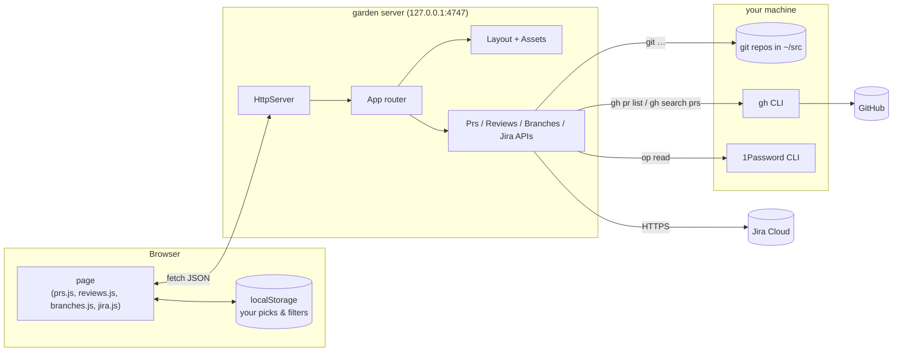
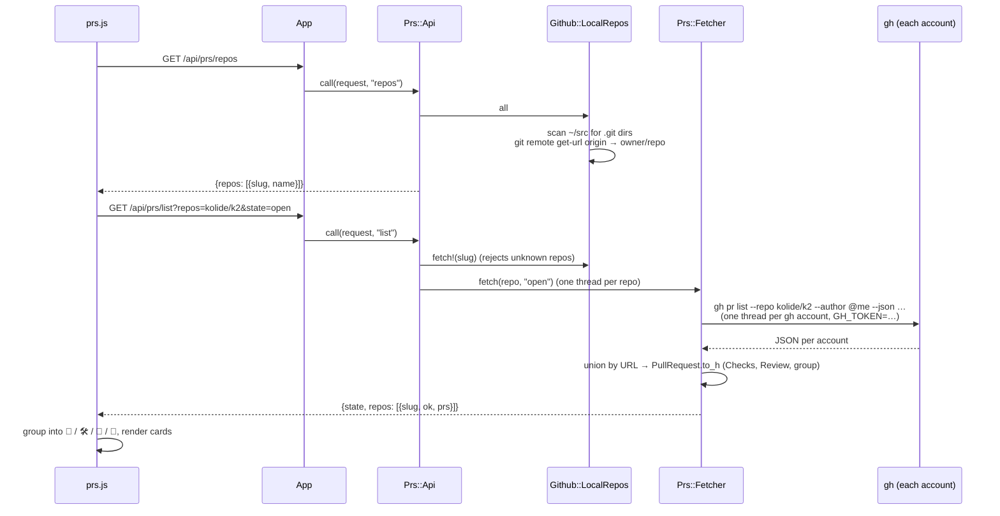
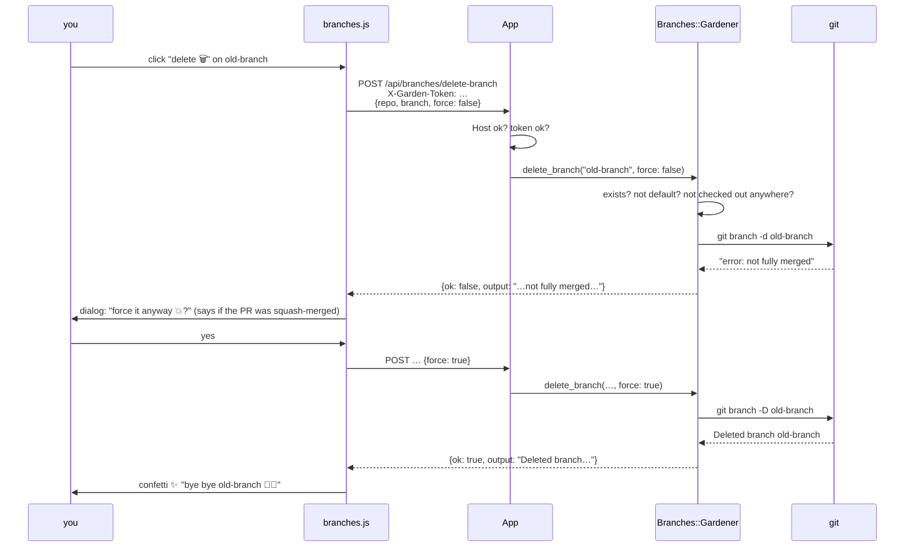

# 🌸 How garden works

A guided tour from the moment you type `garden` to the moment a branch disappears from your disk.

garden is three things glued together:

1. **A tiny Ruby web server** (`bin/garden` + `lib/`) that only listens on your own machine.
2. **Command-line tools you already have** — `git`, `gh`, `op` — which the server runs on your behalf.
3. **Pages in your browser** (`pages/` + `public/`) that ask the server for data and draw it cutely.

No database, no build step, no gems. Everything is Ruby's standard library plus plain HTML/CSS/JS.



---

## 1. Starting up — `bin/garden`

When you run `~/src/garden/bin/garden`:

1. **Options are parsed** (`OptionParser`): `--port` (default 4747), `--root` (default `~/src`), `--jira-site`, `--[no-]open`.
2. **`lib/garden.rb` is loaded.** It requires the stdlib bits (`socket`, `json`, `open3`, `net/http`, `erb`…) and every file under `lib/garden/`.
3. **Tools are registered.** A tool is one page in the suite — `Garden::Tool` (`lib/garden/tool.rb`) is just a little record:

   | slug | emoji | title | API object |
   |---|---|---|---|
   | `prs` | 💌 | pr garden | `Prs::Api` |
   | `reviews` | 👀 | review garden | `Reviews::Api` |
   | `branches` | 🌿 | branch garden | `Branches::Api` |
   | `jira` | 🎟️ | ticket garden | `Jira::Api` |

   Order matters: the **first** tool is the home page and the top of the sidebar.
4. **`Garden::App` is built** (`lib/garden/app.rb`). It invents a random **garden token** (`SecureRandom.hex(16)`) for this run and remembers which `Host` headers are allowed (`localhost:4747`, `127.0.0.1:4747`).
5. **`Garden::HttpServer` starts** (`lib/garden/http_server.rb`): it binds a `TCPServer` to `127.0.0.1` only — nothing on your network can reach it — prints the 🌸 banner and runs `open http://localhost:4747`.

From here the server just loops: accept a connection, hand it to a new thread, repeat. Ctrl-C trips the `INT` trap and it says goodnight 🌙.

---

## 2. The browser asks for a page

### `GET /` → redirect

`App#route` sees `/` and replies `302 Location: /prs` (the first tool's path).

### `GET /prs` → HTML

Inside one request thread:

1. **`HttpServer#read_request`** reads the request line, headers and (for POSTs) up to 64 KB of body, and wraps them in a `Garden::Request` (`method`, `target`, `headers`, `body`, plus helpers `path`, `query`, `params`).
2. **`App#call`** runs two safety checks first:
   - the `Host` header must be `localhost:PORT` or `127.0.0.1:PORT` — this stops a malicious website from pointing a DNS name at 127.0.0.1 and talking to garden ("DNS rebinding");
   - any `POST` must carry `X-Garden-Token` equal to this run's token — other websites can't read your garden page, so they can't learn the token, so they can't forge deletes.
3. **`App#route`** finds the tool whose path is `/prs` and asks **`Layout#render`** (`lib/garden/layout.rb`) for HTML.
4. **Layout** fills in `pages/layout.html.erb` with ERB:
   - the `<meta name="garden-token">` tag (this is how the page learns the token),
   - the emoji **sidebar**, one link per tool, with `aria-current` on the active one,
   - the tool's own **page fragment** (`pages/prs.html.erb`) in the middle,
   - the shared `<dialog>` and toast area,
   - `<link>`s to `/assets/css/garden.css` + `/assets/css/prs.css` and `<script type="module" src="/assets/js/prs.js">`.
5. **`HttpServer#write`** sends it back with `Content-Length`, `Cache-Control: no-store` and `Connection: close`, then the socket closes.

### `GET /assets/…` → static files

The browser then fetches CSS and JS. `App` hands `/assets/*` to **`Garden::Assets`** (`lib/garden/assets.rb`), which serves files from `public/` — but only `.css`, `.js`, `.svg`, `.png`, and only if the resolved path is still inside `public/` (so `/assets/../lib/garden.rb` is a 404). Files are read from disk on every request, so editing CSS/JS only needs a browser reload, not a server restart.

Fonts (Fredoka, Nunito) come from Google Fonts; everything else is local.

---

## 3. The page wakes up — shared JS

Every page script is an ES module that starts with:

```js
import { $, store, esc, api, toast, sprout, … } from './garden.js';
```

`public/js/garden.js` is the shared toolbox:

| helper | what it does |
|---|---|
| `api(path, body?)` | `fetch` wrapper. GET without a body; with a body it POSTs JSON **and adds the `X-Garden-Token` header** read from the meta tag. Always resolves to `{httpOk, ok, …json}` — it never throws, even if the server is down. |
| `store` | `localStorage` with `try/catch`, so private windows don't break anything. |
| `esc` | HTML-escapes anything before it goes into `innerHTML`. |
| `toast`, `openDialog`, `setDialogBusy`, `dialogItem`, `toggle` | the cute notifications and the shared confirm dialog. |
| `sparkle`, `sprout`, `plantFloaties` | confetti, card fade-ins (only on fresh data), and the floating background emoji. |
| `ago`, `ageEmoji`, `plural` | "3d ago 🌱" style formatting. |

**What lives in `localStorage`** (per browser, never sent to the server):
`prs-repos`, `prs-hidden`, `prs-tab` (PR page) · `repo`, `tab`, `branches-sort`, `worktrees-sort` (branches page) · `reviews-excluded`, `reviews-hidden` (review page) · `jira-done`, `jira-sort`, `jira-sprint-sort`, `jira-view`, `jira-sprints-excluded`, `jira-sprints-hidden` (Jira page).

---

## 4. Reading: the PR page, end to end



**Step by step:**

1. **Which repos exist?** `Github::LocalRepos` (`lib/garden/github/local_repos.rb`) asks `Branches::RepoFinder` for every folder directly in `~/src` whose `.git` is a *directory* (linked worktrees have a `.git` *file*, so they're skipped). For each, `git remote get-url origin` → the last two path pieces → `owner/repo`. Checkouts of the same GitHub repo (like `k2.5` and `k3`) collapse into one entry; repos with no remote are dropped. The scan is cached for 60 s.
2. **The side panel** is drawn from that list. Your ticks live in `localStorage` (`prs-repos`), hidden repos in `prs-hidden`. Nothing about your selection is stored on the server.
3. **Fetching PRs.** For the chosen repos and state, `Prs::Fetcher` (`lib/garden/prs/fetcher.rb`):
   - asks `Github::Accounts` (`lib/garden/github/accounts.rb`) for every logged-in gh account — the active one plus any others from `gh auth status --json hosts`;
   - runs `gh pr list --repo SLUG --author @me --state STATE --json …` **once per account**, each with that account's token in `GH_TOKEN` (fetched via `gh auth token --user LOGIN`), so your active gh account is never switched;
   - merges the results by URL — this matters because "`@me`" is a different person for `autumn-forsythe_1pw` and `adccb`;
   - for `closed`, drops merged PRs (gh's "closed" includes them), sorts by date and keeps 30;
   - caches each `(repo, state)` answer for 90 s. The 🔄 button sends `refresh=1` to skip the cache.
4. **Deciding the section.** `Prs::PullRequest` (`lib/garden/prs/pull_request.rb`) flattens each PR and computes `group`, using two helpers:
   - `Prs::Checks` turns `statusCheckRollup` into `passing` / `failing` / `pending` / `none` with counts;
   - `Prs::Review` pulls out `decision`, who's `requested`, `approved_by`, `changes_by`, `commented_by` (bots filtered out).

   | group | rule (open PRs only, first match wins) |
   |---|---|
   | 🧸 `drafts` | `isDraft` |
   | 🛠️ `needs_work` | changes requested, **or** a failing check, **or** merge conflicts |
   | 💖 `mergeable` | checks passing/none **and** (approved, **or** no review required and GitHub says `CLEAN`) |
   | 👀 `waiting` | everything else (review required, checks still running) |

   GitHub's own `mergeStateStatus` is often `UNKNOWN` or `BLOCKED` (branch protection) even when a PR is good to go, so garden judges "mergeable" from approval + checks + conflicts instead.
5. **Drawing.** `prs.js` keeps results per state in `ui.results[state]` (a `Map` of slug → repo result), builds the tabs (✨ all + one per checked repo), and renders the four sections. Merged/closed are fetched the first time you click those chips, then reused.

---

## 5. Reading: the branches page

Same shape, different tools:

`branches.js` → `GET /api/branches/repos` and `GET /api/branches/state?repo=…` → `Branches::Api` → `Branches::Snapshot`, which runs in parallel:

- **`BranchReport`** — one `git for-each-ref refs/heads` call that returns name, date, subject, upstream, `[gone]`, and `ahead-behind` against `origin/HEAD`; plus `git branch --merged` for the "merged in git" set.
- **`WorktreeReport`** — `git worktree list --porcelain`, then `git status --porcelain` in each worktree (in threads) to count unsaved changes. This is the slow bit on k2: about 3 s across 20 checkouts.
- **`Branches::PullRequests`** — one `gh pr list --state all` per repo (cached 2 min) so squash-merged branches show as 💖 merged even though git can't tell.

The JSON comes back as `{branches, worktrees, default_branch, pr_info}` and `branches.js` does all filtering, sorting and searching in the browser.

---

## 6. And back again: deleting things

This is the only part of garden that changes your disk, so it has the most guard rails.



**The guard rails, in order:**

1. **Browser**: the page only offers delete on branches that aren't the default, aren't checked out, and aren't in a worktree; bulk actions show exactly what will run before anything happens.
2. **`App`**: wrong `Host` or missing/wrong token → 403.
3. **`Branches::Api`**: `RepoFinder#fetch` rejects any repo that isn't in `~/src`.
4. **`Branches::Gardener`** (`lib/garden/branches/gardener.rb`):
   - the branch must exist in `git for-each-ref`;
   - it can't be the default branch 👑;
   - it can't be checked out in *any* worktree 🔒;
   - worktree removal refuses the main checkout 🏰 and any path not in `git worktree list`.

   These raise `Garden::Refusal`, which `App` turns into `422 {ok: false, error: "…"}`.
5. **git itself**: garden always tries the safe command first (`git branch -d`, `git worktree remove` without `--force`). git refuses unmerged branches and dirty worktrees, and garden shows you git's own message before offering the force version.
6. **Everything is argv, never a shell string**: `Open3.capture3("git", "-C", repo, "branch", "-d", name)` — a branch name can't smuggle in shell commands.
7. **Local only**: nothing ever pushes, deletes remote branches, or writes to GitHub.

**Bulk tidy** (branches or worktrees) is the same calls in a loop, one at a time, with a ✅/❌ per item and a "force the N stragglers 💥" retry for anything git refused. For worktrees with "also delete their branches" checked, it's `remove-worktree` then `delete-branch` per item; if the worktree went but the branch stayed, the retry only touches the branch.

---

## 7. The Jira page

`jira.js` → `GET /api/jira/tickets?done=0|1` → `Jira::Api`:

1. **Credentials** (`lib/garden/jira/credentials.rb`): `op read $JIRA_TOKEN_REF` for the API token, and the same item's `username` field (or `$JIRA_EMAIL`) for your Atlassian email. That's the Touch ID prompt. Both live only in server memory, and are forgotten on a 401.
2. **Client** (`lib/garden/jira/client.rb`): `Net::HTTP` with basic auth. It calls `/rest/api/3/myself` first, because Jira answers bad credentials on search as an *anonymous* user with zero results instead of an error.
3. **Search**: `POST /rest/api/3/search/jql` with `assignee = currentUser() AND statusCategory != Done` (or "… OR resolved >= -30d" with the done toggle), paging up to 500. Cached 60 s.
4. **Ticket** (`lib/garden/jira/ticket.rb`) flattens each issue for the cards, including its assignee, whether it's yours, and its parent's key, summary, type and status.
4½. **Sprint tabs**: `GET /api/jira/sprints` finds the Sprint custom field (`/rest/api/3/field`, by its `gh-sprint` schema type), searches `assignee = currentUser() AND sprint in openSprints()` for just that field, and returns each non-closed sprint with how many of your tickets it holds. The 🏃 side panel lists them (`public/js/scope-panel.js`, shared with the review page) and each checked one becomes a tab. `GET /api/jira/tickets?view=sprint&sprint=<id>` reads the sprint (`/rest/agile/1.0/sprint/<id>`) and searches `sprint = <id> ORDER BY Rank ASC`, keeping that board order. In the browser, every tab is grouped into horizontal swimlanes by parent ticket (parentless tickets last); clicking a lane's heading opens the parent in the drawer.
5. **Opening a ticket**: `GET /api/jira/ticket?key=KOL-1447` (key format checked) → the issue with its description, which **`Jira::Adf`** (`lib/garden/jira/adf.rb`) converts from Atlassian Document Format to HTML — every string escaped, only `http(s)` links kept — before the drawer shows it.

---

## 7½. The task page

The only page that keeps its own data. `tasks.js` → `/api/tasks/{list,create,update,delete,restore}` → `Tasks::Store` (`lib/garden/tasks/store.rb`), which reads and writes one JSON file: `~/.local/share/garden/tasks.json` (or `--data-dir`).

- Every change takes a lock, loads the file, edits the list and writes it back to a `.tmp` file before renaming it into place, so a crash never leaves half a list.
- Titles are trimmed, newlines squashed, 1–500 characters. A task is just `{id, title, created_at, done_at}`; "done" means `done_at` is set.
- Undo after a delete sends the deleted task back to `restore`, which re-validates it (UUID id, real timestamps) and refuses duplicates.
- All the keyboard handling lives in the browser: one `keydown` listener maps keys to actions, ignoring them while you type or while a dialog is open, and focus is moved to the next task after every change so you never lose your place.

---

**Your Todoist filter.** If `TODOIST_TOKEN_REF` is set, `Tasks::TodoistToday` (`lib/garden/tasks/todoist_today.rb`) asks Todoist's sync endpoint for your saved filters and account language, and finds the one named by `TODOIST_FILTER` (default `aujourd'hui`; matching ignores case, emoji and apostrophe style). `Todoist::SavedFilter` (`lib/garden/todoist/saved_filter.rb`) splits its query on top-level commas, because the API refuses them, and swaps the French, Spanish or Japanese inbox name ("Boîte de réception", "Bandeja de entrada", "インボックス") for your inbox's real name, which is the only one the API knows. Each part is fetched separately with `GET /api/v1/tasks/filter?query=…&lang=<your language>` and becomes its own tab. Tasks are flattened by `Todoist::Task` (Todoist's priority 4 is its red "p1") and sorted overdue first, then by priority and time. The filter setup is cached 10 min, task lists 30 s. Checking off calls `POST /api/v1/tasks/:id/close` and unchecking `…/reopen`; recurring tasks can't be unchecked because Todoist has already moved them on. The token comes from `op read` via `Garden::Secrets` on first use and lives only in memory.

---

## 7¾. English, French, Spanish and Japanese

Every word you see comes from `locales/<lang>/<area>.yml` (`common`, `errors`, `prs`, `reviews`, `tasks`, `branches`, `jira`).

- **Picking a language** (`Garden::Locale`, in `lib/garden/i18n.rb`): the `garden_locale` cookie wins, then your browser's `Accept-Language`, then English. The language menu (🍔 English, 🥐 French, 🌽 Spanish, 🍙 Japanese) at the bottom of the sidebar sets the cookie and reloads.
- **Picking a palette** (`Garden::Palette`, in `lib/garden/palette.rb`): the `garden_palette` cookie, else fairyfloss. The layout puts it on `<html data-palette=…>`, so `public/css/palettes.css` recolors the page before it paints. The color menu above the language one sets the cookie and swaps `data-palette` in place, no reload. Both menus share `public/js/sidebar-menu.js`.
- **On the server**, `Garden::I18n.t(locale, key, **vars)` looks keys up (falling back to English, then to the key itself with a `🌐 missing translation` warning in the terminal) and fills `%{vars}`. YAML files reload automatically when they change.
- **In templates**, `pages/*.html.erb` render through `Garden::View`, so they write `<%= t('tasks.new_task') %>`. Text is HTML-escaped unless the key ends in `_html` (used for strings with `<kbd>` in them).
- **In the browser**, the layout embeds that page's strings as JSON (`<script id="garden-i18n">`). `garden.js` exposes `t(key, vars)`, `tp(key, count)` for plurals via `Intl.PluralRules` (French counts 0 as singular; Japanese has no singular), `pick(key)` for random cheers, plus `ago()` and `formatDate()` built on `Intl` so times and dates read naturally in each language.
- **Errors**: server code raises `Refusal.new('errors.task_empty')` (or `Jira::Error.new(…)`), and `App` translates it into the requester's language just before replying. Results that are cached for everyone (like a repo `gh` can't see) carry an `error_key` instead, which the browser translates.
- **Not translated on purpose**: your content (task text, PR titles, Jira data) and git's own messages.

**Adding a string:** put the same key in `locales/<lang>/<area>.yml` for every language (`en`, `fr`, `es`, `ja`), then use `t('<area>.<key>')` in the template or JS. Reload the page; no restart needed.

---

## 8. Caches at a glance

| what | where | how long | bypass |
|---|---|---|---|
| repo list (owner/repo per checkout) | `Github::LocalRepos` | 60 s | restart |
| your PRs per repo + state | `Prs::Fetcher` | 90 s | 🔄 on PR page |
| PR badges on the branches page | `Branches::PullRequests` | 120 s | 🔄 on branches page |
| Jira ticket list | `Jira::Api` | 60 s | 🔄 on Jira page |
| Jira email + token | `Jira::Credentials` | until restart or a 401 | restart |
| your selections, filters, tabs | browser `localStorage` | forever | clear site data |

Everything server-side is in memory, so restarting garden starts fresh.

---

## 9. Map of the files

```
bin/garden                     start here: options, tool list, boot
lib/garden.rb                  requires everything
lib/garden/
  http_server.rb               TCP socket → Request → App → response bytes
  app.rb                       host/token checks, routing: / · /<tool> · /assets/* · /api/<tool>/<action>
  layout.rb + assets.rb        HTML shell (ERB) and static files
  responses.rb                 json / html / redirect / not_found helpers
  tool.rb                      the Tool record (slug, emoji, title, api)
  git.rb                       Open3 wrapper around `git -C dir …`
  github/                      gh accounts, ~/src → owner/repo
  prs/                         💌 api, fetcher, pull_request, checks, review
  reviews/                     👀 api, search, request
  branches/                    🌿 api, snapshot, branch/worktree reports, gardener, PR badges
  jira/                        🎟️ api, client, credentials, ticket, adf
pages/
  layout.html.erb              sidebar + dialog + toasts around every page
  <slug>.html.erb               each page's middle bit (prs, reviews, tasks, branches, jira)
locales/
  en/ fr/ es/ ja/ *.yml        every word on every page, per area
public/
  css/garden.css               palette (light/dark), cards, chips, tabs, sidebar, animations
  css/<tool>.css               page-specific styles
  js/garden.js                 shared helpers (api, store, toast, dialog, sparkles)
  js/<tool>.js                 each page's logic
```

---

## 10. Poking at it yourself

- **Watch the server**: errors print in the terminal you started garden from, prefixed with 🥀.
- **Call the API directly** (GETs need no token):
  ```sh
  curl -s localhost:4747/api/prs/repos | jq
  curl -s 'localhost:4747/api/prs/list?repos=kolide/k2&state=open' | jq '.repos[0].prs[] | {number, group, review, checks}'
  curl -s "localhost:4747/api/branches/state?repo=$HOME/src/k2" | jq '.worktrees | length'
  ```
- **Change a page**: edit `public/` or `pages/*.html` and reload. Ruby changes (`lib/`, `bin/`) need a restart.
- **Add a tool**: see the README. In short, an `Api` class with `call(request, action)`, a page fragment, a JS module and a CSS file, then one `Garden::Tool.new(…)` line in `bin/garden`.
