# 📸 garden, bien arreglado

Un paseo por cada página con los colores predeterminados 🍭 fairyfloss, ☀️ en claro a la izquierda y 🌙 en oscuro a la derecha. Todo lo que ves es inventado: el equipo «sunbeam-labs», sus repos, PR, tickets y tareas vienen de [`demo/fixtures.rb`](demo/fixtures.rb), no de GitHub, Jira ni Todoist.

[🍔 English](README.md) · [🥐 Français](README.fr.md) · **🌽 Español** · [🍙 日本語](README.ja.md)  
🎨 [Cada página en las otras paletas (en inglés)](palettes.md)

## 💌 jardín de PR

Tus PR abiertas, agrupadas en listas para fusionar, por pulir, esperando revisión y borradores, con el panel de repos a la izquierda.
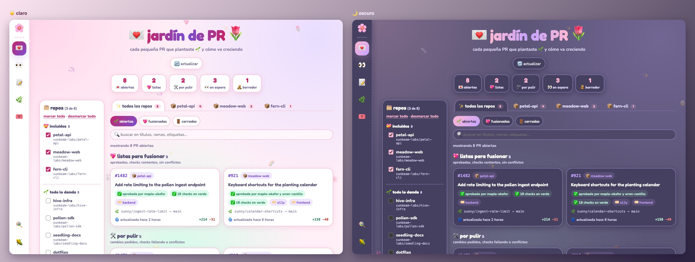

El filtro de fusionadas, para admirar lo que ya llegó.
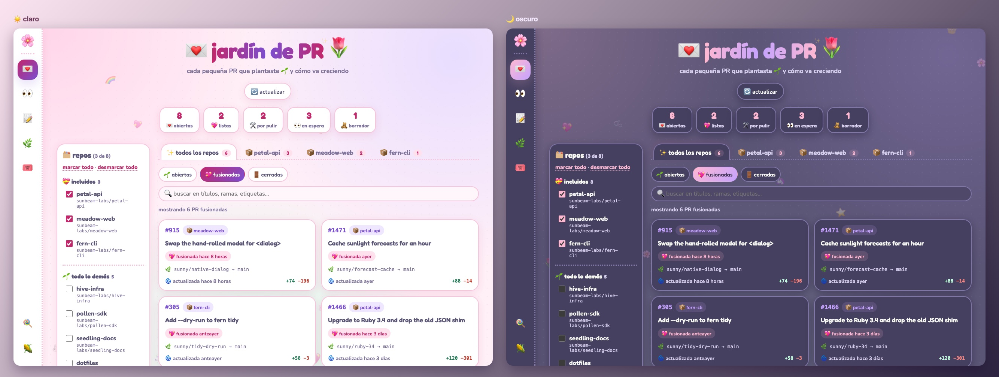

## 👀 jardín de revisiones

Las PR que te pidieron revisión por tu nombre.
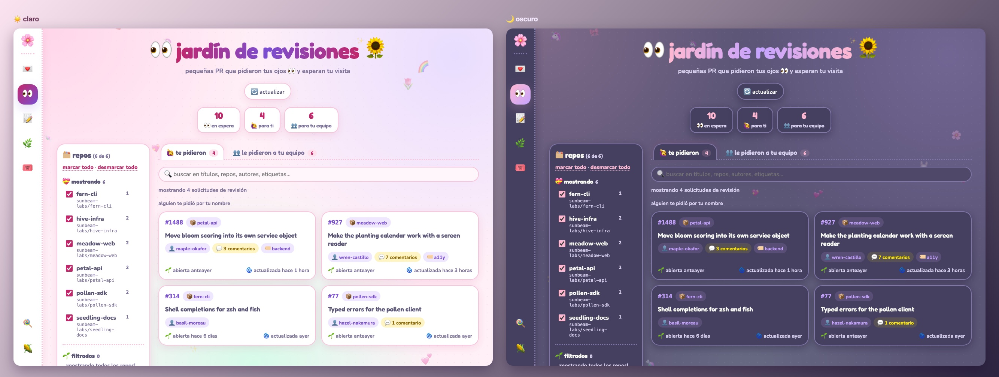

La pestaña del equipo, con un repo desmarcado y otro guardado entre los ocultos.
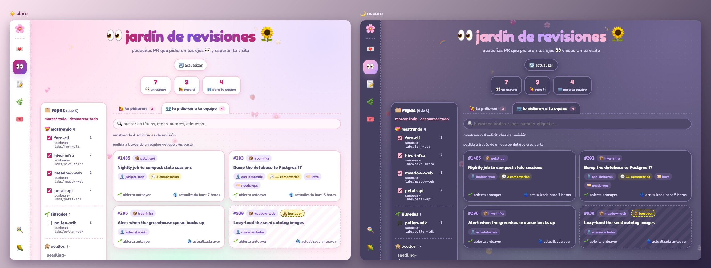

## 📝 jardín de tareas

El filtro de Todoist de hoy en pestañas, tus propias tareas abajo y la lista de hechas abierta.
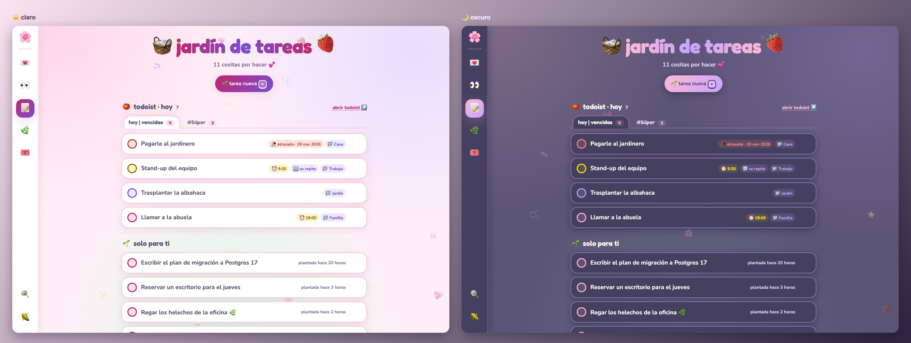

Plantar una tarea nueva (`c`).
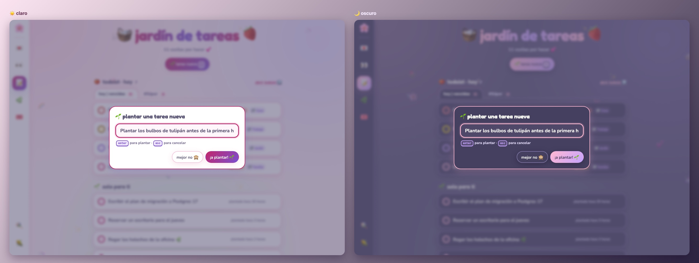

La ayuda del teclado (`?`).
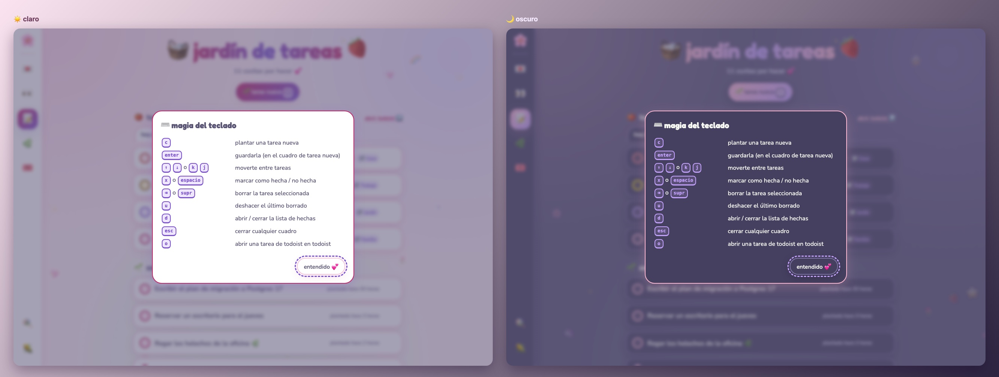

## 🌿 jardín de ramas

Las ramas locales con el estado de su PR, su upstream y su worktree.
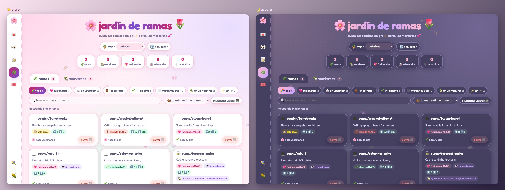

Ordenar dos ramas fusionadas de una vez.
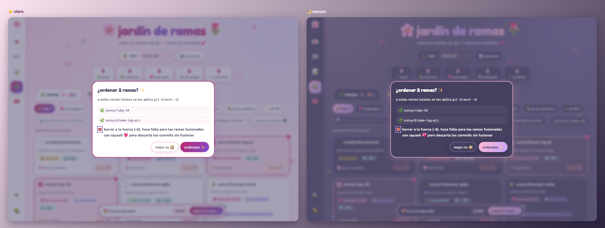

Los worktrees, incluido un fantasma cuya carpeta ya no existe.
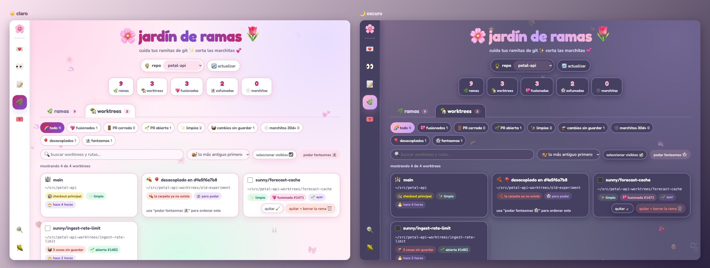

## 🎟️ jardín de tickets

Tus tickets en carriles por épica, con el panel de sprints a la izquierda.
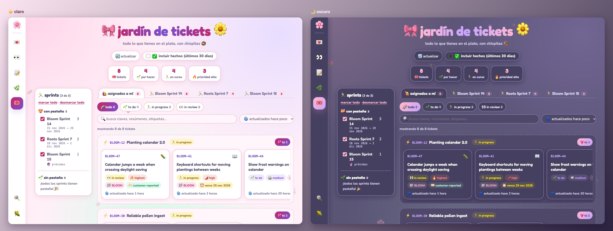

Una pestaña de sprint, con los tickets de todo el equipo y un filtro por persona en cada carril.
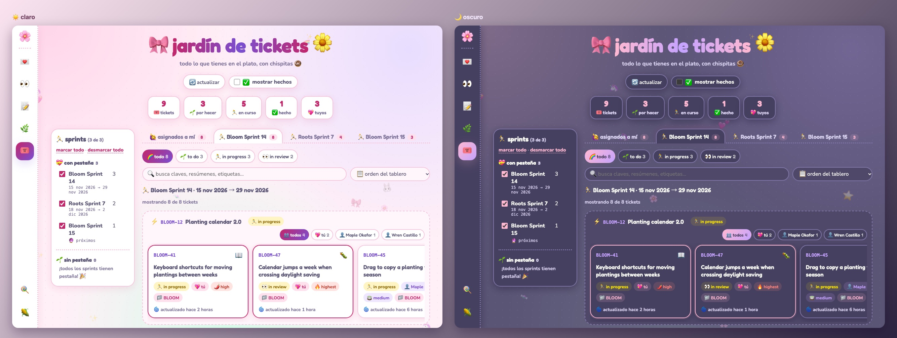

Un ticket abierto en el panel lateral.
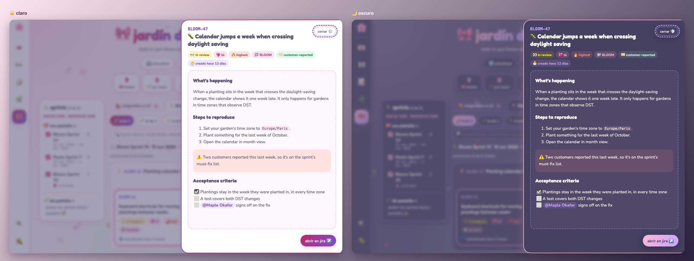

## 🎨 colores

El menú de colores al pie de la barra lateral, encima del de idiomas.
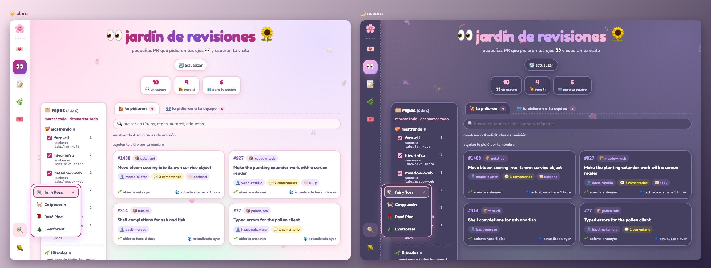

## Cómo volver a tomarlas

El servidor de demo corre las páginas reales con cada API cambiada por los datos inventados, y cada `?scene=` prepara una página (pestañas, diálogos, filtros guardados). El fotógrafo maneja Chrome sin interfaz, así que necesita Google Chrome instalado; después `gallery.rb` reescribe estas páginas.

```sh
ruby docs/screenshots/demo/demo_garden.rb &                     # http://localhost:4750
ruby docs/screenshots/demo/shoot.rb docs/screenshots            # cada escena, idioma y paleta
ruby docs/screenshots/demo/shoot.rb docs/screenshots 12-ticket  # solo una escena
ruby docs/screenshots/demo/gallery.rb                           # reescribir las galerías
```

Las escenas viven en [`demo/scenes.rb`](demo/scenes.rb) y los textos al pie en [`demo/gallery.rb`](demo/gallery.rb).
