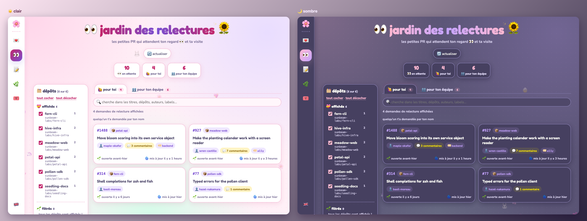
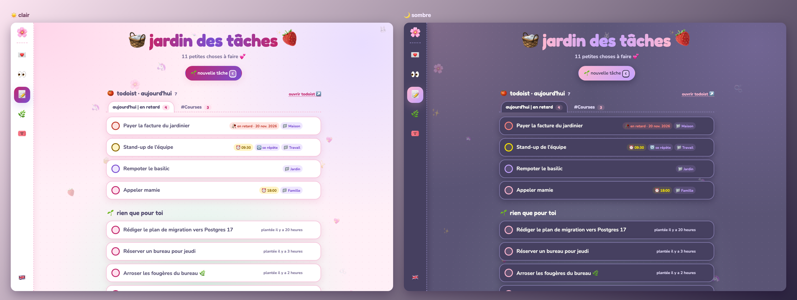
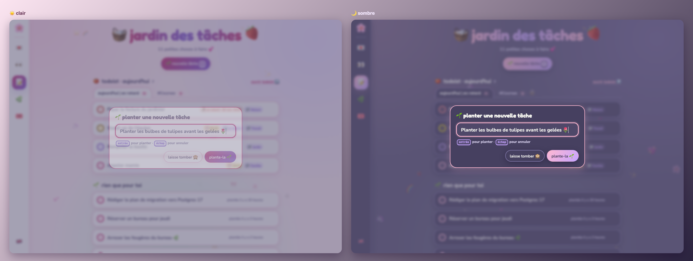
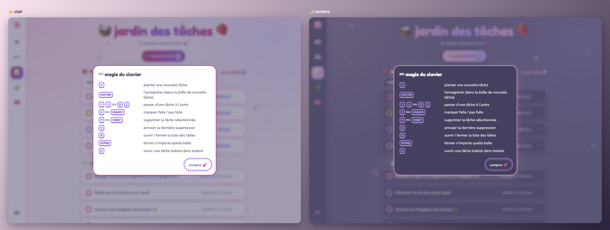
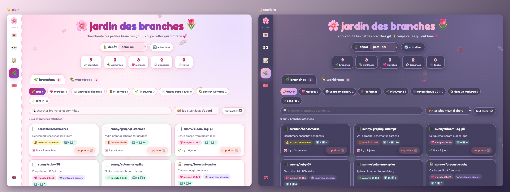
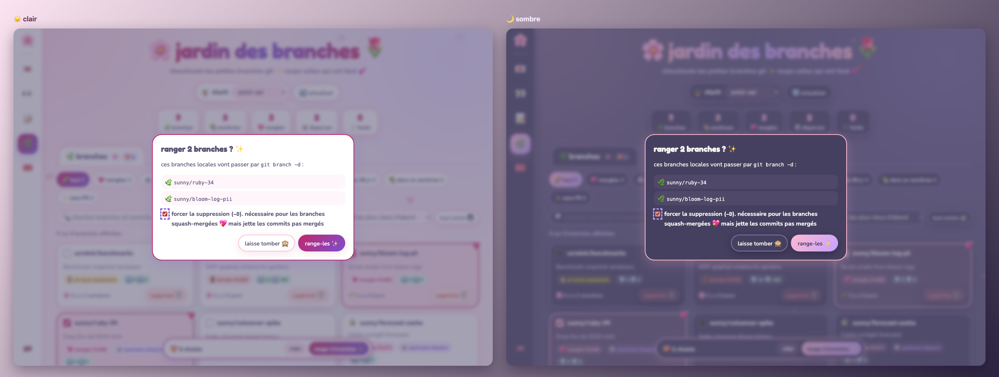
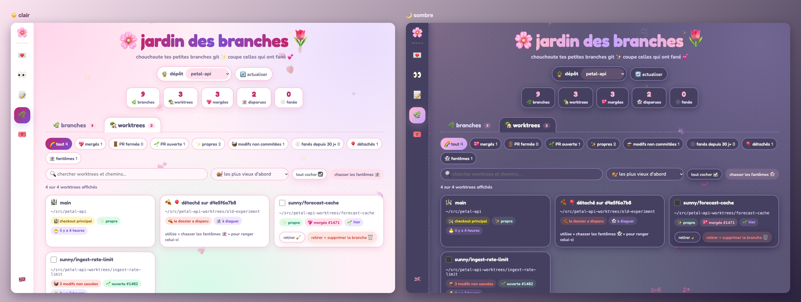
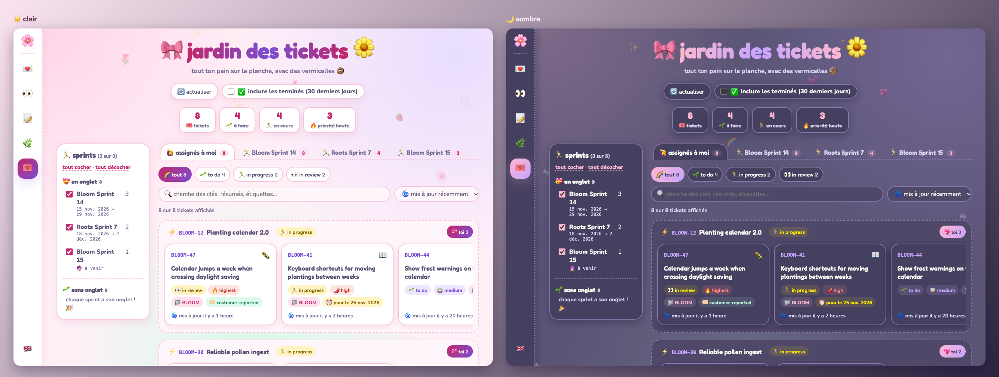
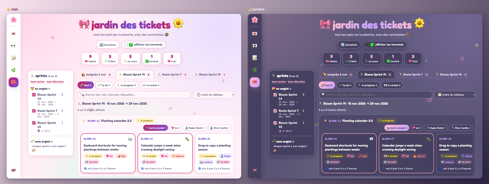
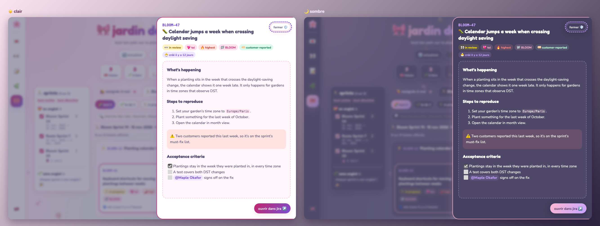

# 📸 garden, sur son trente-et-un

Une visite de chaque page, ☀️ en clair à gauche et 🌙 en sombre à droite. Tout ce que tu vois est inventé :
l'équipe « sunbeam-labs », ses dépôts, ses PR, ses tickets et ses tâches viennent de
[`demo/fixtures.rb`](demo/fixtures.rb), pas de GitHub, Jira ou Todoist.

🇬🇧 [This tour is also in English.](README.md)

## 💌 jardin des PR

Tes PR ouvertes, rangées en prêtes à merger, à retravailler, en attente de relecture et brouillons, avec la liste
des dépôts à gauche.


Le filtre « fusionnées », pour admirer ce qui a déjà atterri.


## 👀 jardin des relectures

Les PR qui t'ont demandée par ton nom.


L'onglet équipe, avec un dépôt décoché et un autre mis de côté dans les cachés.


## 📝 jardin des tâches

Le filtre Todoist du jour en onglets, tes propres tâches en dessous, et la liste des terminées ouverte.


Planter une nouvelle tâche (`c`).


L'aide du clavier (`?`).


## 🌿 jardin des branches

Les branches locales avec l'état de leur PR, leur upstream et leur worktree.


Ranger deux branches mergées d'un coup.


Les worktrees, dont un fantôme dont le dossier a disparu.


## 🎟️ jardin des tickets

Tes tickets en couloirs par epic, avec la liste des sprints à gauche.


Un onglet de sprint, avec les tickets de toute l'équipe et un filtre par personne dans chaque couloir.


Un ticket ouvert dans le tiroir.


## Les refaire

Le serveur de démo fait tourner les vraies pages, avec chaque API remplacée par les données inventées, et chaque
`?scene=` met une page en scène (onglets, fenêtres, filtres enregistrés). Le photographe pilote Chrome sans interface,
donc il faut que Google Chrome soit installé.

```sh
ruby docs/screenshots/demo/demo_garden.rb &                      # http://localhost:4750
ruby docs/screenshots/demo/shoot.rb docs/screenshots             # les 13 scènes × en/fr
ruby docs/screenshots/demo/shoot.rb docs/screenshots 12-ticket   # juste une
```

Les scènes vivent dans [`demo/scenes.rb`](demo/scenes.rb) ; ajoutes-en une et les deux scripts la prennent en compte.
