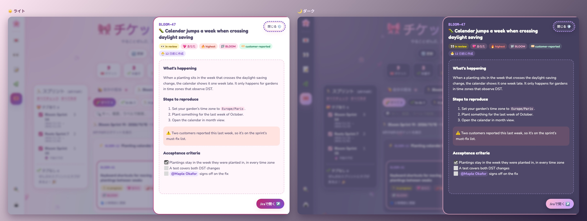

# 📸 おめかしした garden

デフォルトの 🍭 fairyfloss カラーで全ページをめぐるツアー。左が ☀️ ライト、右が 🌙 ダーク。ここに写っているものはすべて架空のもの：「sunbeam-labs」チーム、そのリポジトリ、PR、チケット、タスクは GitHub や Jira、Todoist ではなく [`demo/fixtures.rb`](demo/fixtures.rb) から来ているよ。

[🍔 English](README.md) · [🥐 Français](README.fr.md) · [🌽 Español](README.es.md) · **🍙 日本語**  
🎨 [ほかのカラーパレットで見る全ページ（英語）](palettes.md)

## 💌 PRのお庭

オープンな PR を「マージできる」「手直し」「レビュー待ち」「ドラフト」に分けて表示。左はリポジトリのパネル。


「マージ済み」で、もう着地したものをながめる。


## 👀 レビューのお庭

名前指定でレビューを依頼された PR。


チームのタブ。リポジトリをひとつチェックから外し、もうひとつは隠したものへ。


## 📝 タスクのお庭

今日の Todoist フィルターをタブで、その下に自分のタスク、完了リストも開いた状態。


新しいタスクを植える（`c`）。


キーボードのヘルプ（`?`）。


## 🌿 ブランチのお庭

ローカルブランチと、その PR の状態、upstream、ワークツリーのバッジ。


マージ済みのブランチをふたつまとめてお片付け。


ワークツリー。フォルダが消えたおばけもいるよ。


## 🎟️ チケットのお庭

エピックごとのレーンに並んだ自分のチケット。左はスプリントのパネル。


スプリントのタブ。チーム全員のチケットと、レーンごとの担当者フィルター。


パネルで開いたチケット。


## 🎨 色

サイドバーの下にある色のメニュー。言語メニューのすぐ上。


## 撮り直しかた

デモサーバーは本物のページを動かしつつ、すべての API を架空のデータに差し替えているよ。`?scene=` ごとにページを演出（タブ、ダイアログ、保存したフィルター）するんだ。撮影係はヘッドレスの Chrome を操作するので、Google Chrome が必要。そのあと `gallery.rb` がこれらのページを書き直すよ。

```sh
ruby docs/screenshots/demo/demo_garden.rb &                     # http://localhost:4750
ruby docs/screenshots/demo/shoot.rb docs/screenshots            # 全シーン、全言語、全パレット
ruby docs/screenshots/demo/shoot.rb docs/screenshots 12-ticket  # ひとつのシーンだけ
ruby docs/screenshots/demo/gallery.rb                           # ギャラリーを書き直す
```

シーンは [`demo/scenes.rb`](demo/scenes.rb)、キャプションは [`demo/gallery.rb`](demo/gallery.rb) にあるよ。
