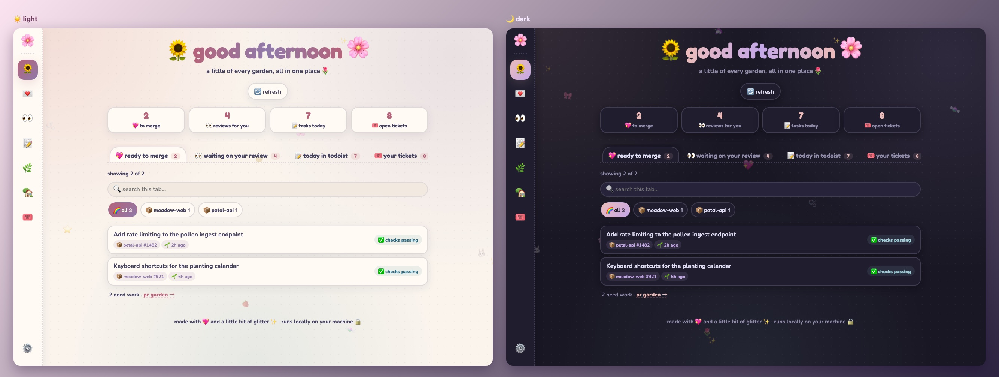
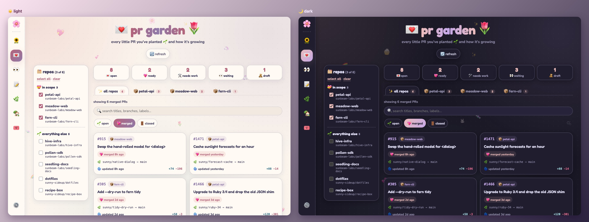
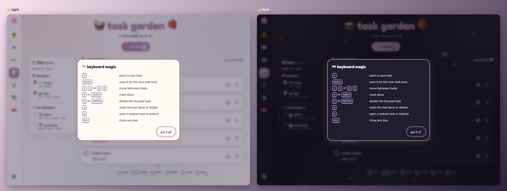
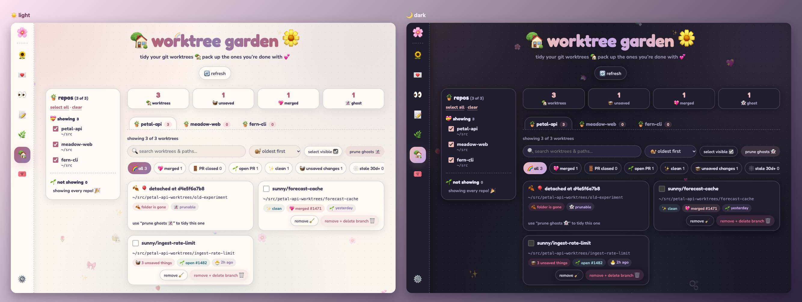

# 📸 garden, all dressed up

A walk through every page in the default 🌹 Rosé Pine colors, ☀️ light on the left and 🌙 dark on the right. Everything you see is invented: the "sunbeam-labs" team, its repos, PRs, tickets and to-dos come from [`demo/fixtures.rb`](demo/fixtures.rb), not from GitHub, Jira or Todoist.

**🍔 English** · [🥐 Français](README.fr.md) · [🌽 Español](README.es.md) · [🍙 日本語](README.ja.md)  
🎨 [Every page in the other color schemes](palettes.md) · 🧺 [Each garden in every color](by-page/README.md)

## 🌻 home

The home page: what's ready to merge, waiting on your review, due today and on your plate in Jira.


## 💌 pr garden

Your open PRs, grouped into ready to merge, needs work, waiting on review and drafts, with a repo panel on the left.


The merged chip, for admiring what already landed.


## 👀 review garden

PRs that asked for your review by name.


The team tab, with one repo unchecked in the panel.


## 📝 task garden

The lists panel on the left, with today and late showing as tabs.


Planting a new task (`c`).


The keyboard help (`?`).


## 🌿 branch garden

One tab per repo in the panel, its branches showing PR state, upstream and worktree badges.


Tidying two merged branches at once.


## 🏡 worktree garden

One tab per repo of worktrees, including a ghost whose folder is gone.


## 🎟️ ticket garden

Your tickets in swimlanes by epic, with the sprints panel on the left.


A sprint tab, with everyone's tickets and per-lane people filters.


A ticket opened in the drawer.


## ⚙️ settings

Colors and language up top, which pages the sidebar shows, then hiding repos everywhere at once; the repo list comes from GitHub.


## Retaking them

The demo server runs the real pages with every API swapped for the invented data, and each `?scene=` stages a page (tabs, dialogs, saved filters). The shooter drives headless Chrome, so it needs Google Chrome installed; `gallery.rb` then rewrites these pages.

```sh
ruby docs/screenshots/demo/demo_garden.rb &                     # http://localhost:4750
ruby docs/screenshots/demo/shoot.rb docs/screenshots            # every scene, every language and palette
ruby docs/screenshots/demo/shoot.rb docs/screenshots 12-ticket  # just one scene
ruby docs/screenshots/demo/gallery.rb                           # rewrite the gallery pages
```

Scenes live in [`demo/scenes.rb`](demo/scenes.rb), captions in [`demo/gallery.rb`](demo/gallery.rb).
