# 📸 garden, all dressed up

A walk through every page, ☀️ light on the left and 🌙 dark on the right. Everything you see is invented: the
"sunbeam-labs" team, its repos, PRs, tickets and to-dos come from [`demo/fixtures.rb`](demo/fixtures.rb), not from
GitHub, Jira or Todoist.

🇫🇷 [Cette visite existe aussi en français.](README.fr.md)

## 💌 pr garden

Your open PRs, grouped into ready to merge, needs work, waiting on review and drafts, with a repo panel on the left.
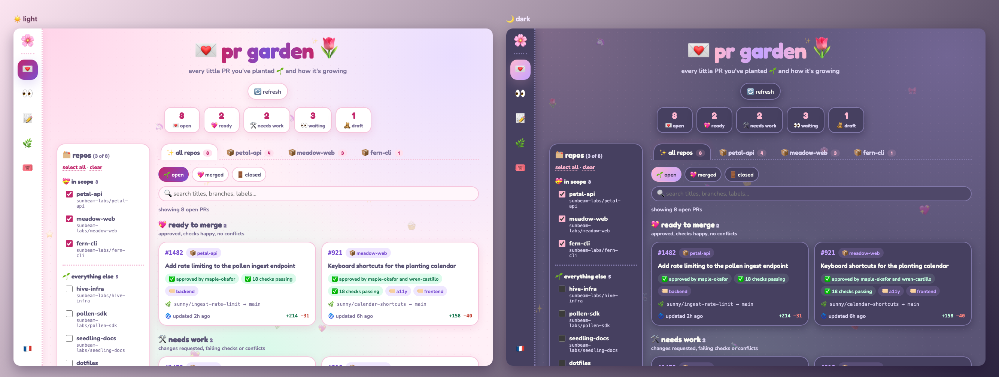

The merged chip, for admiring what already landed.
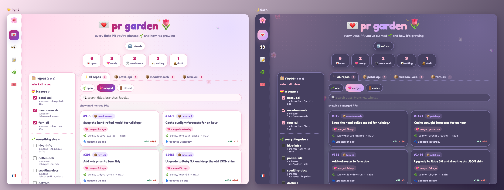

## 👀 review garden

PRs that asked for your review by name.
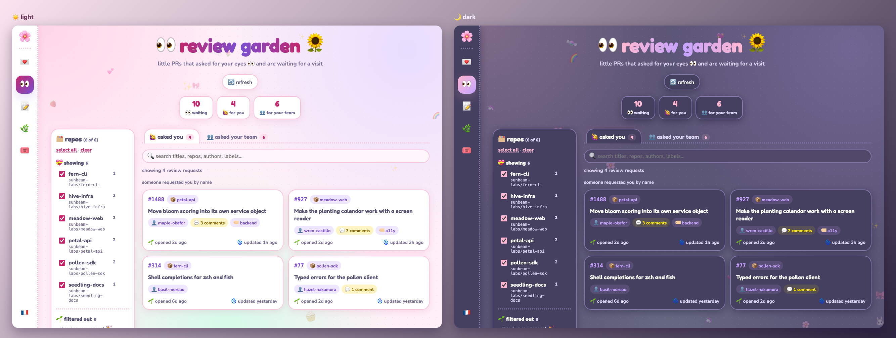

The team tab, with one repo unticked and another tucked into the hidden group.


## 📝 task garden

Today's Todoist filter in tabs, your own tasks below, and the done list open.
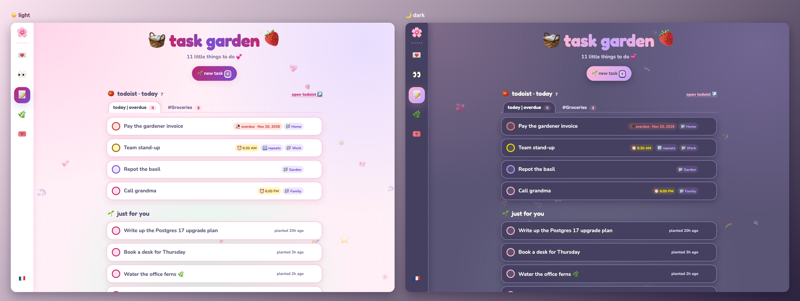

Planting a new task (`c`).
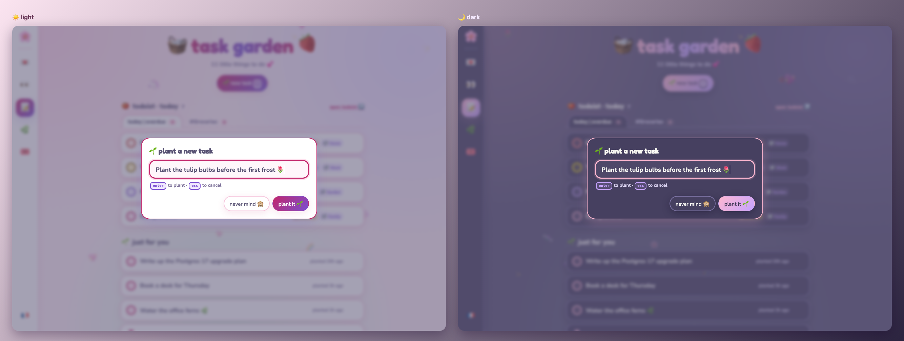

The keyboard help (`?`).
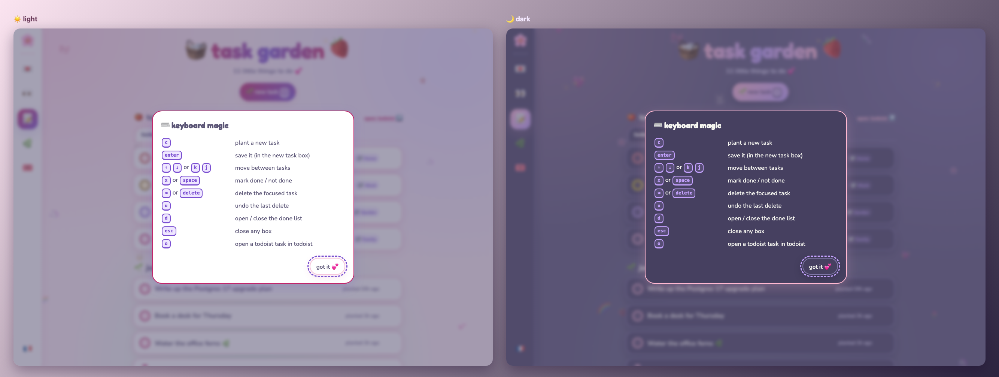

## 🌿 branch garden

Local branches with their PR state, upstream and worktree badges.
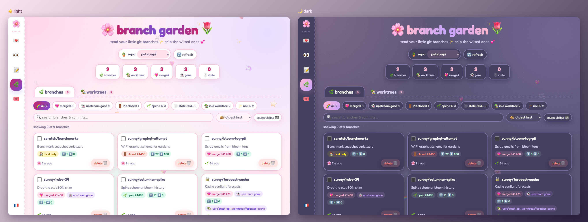

Tidying two merged branches at once.
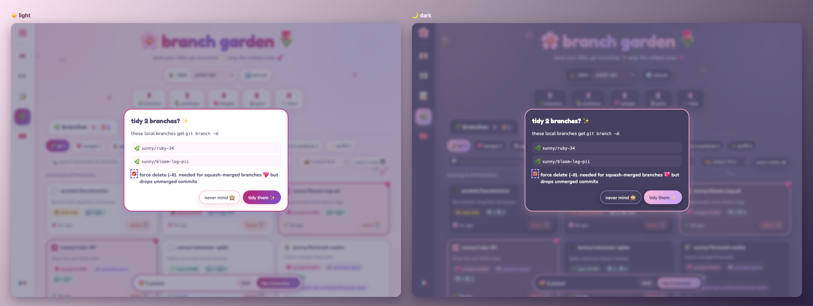

Worktrees, including a ghost whose folder is gone.
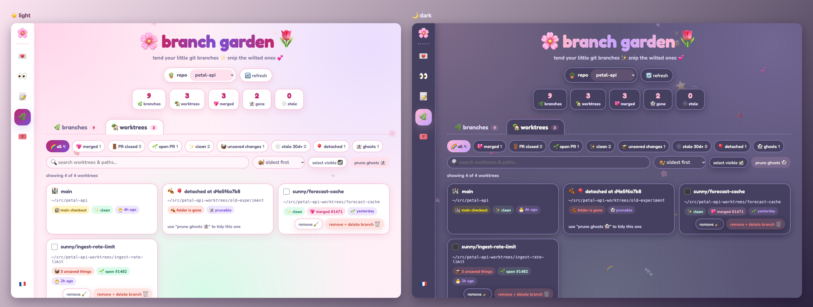

## 🎟️ ticket garden

Your tickets in swimlanes by epic, with the sprints panel on the left.
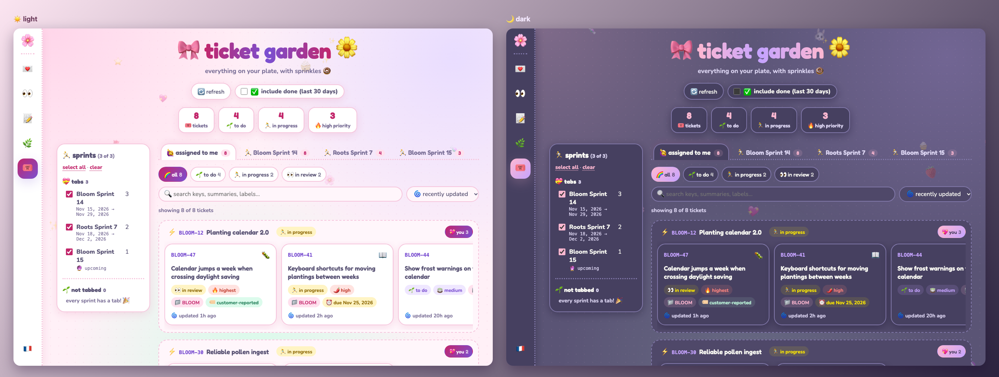

A sprint tab, with everyone's tickets and per-lane people filters.
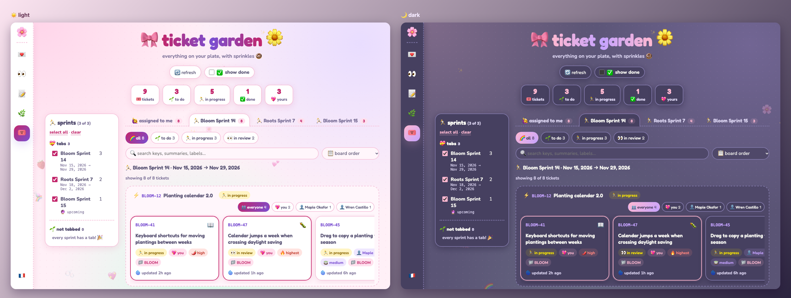

A ticket opened in the drawer.
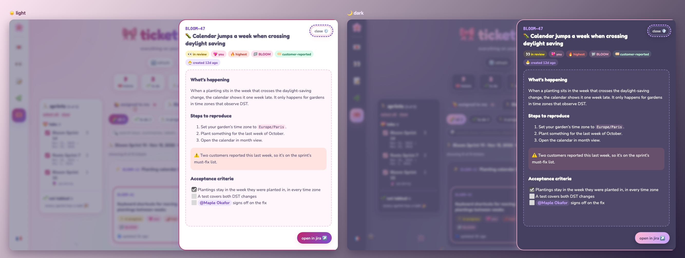

## Retaking them

The demo server runs the real pages with every API swapped for the invented data, and each `?scene=` stages a page
(tabs, dialogs, saved filters). The shooter drives headless Chrome, so it needs Google Chrome installed.

```sh
ruby docs/screenshots/demo/demo_garden.rb &                      # http://localhost:4750
ruby docs/screenshots/demo/shoot.rb docs/screenshots             # all 13 scenes × en/fr
ruby docs/screenshots/demo/shoot.rb docs/screenshots 12-ticket   # just one
```

Scenes live in [`demo/scenes.rb`](demo/scenes.rb); add one there and it's picked up by both.
